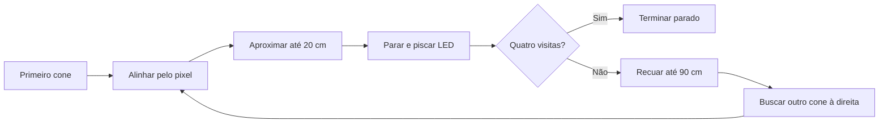

# Robô Trekking — cones laranja

O código detecta cones laranja, calcula o centro da caixa na imagem, usa esse pixel para esterçar, aproxima até a referência de 20 cm da frente do robô, para e pisca o LED três vezes. Para quatro cones, recua medindo a distância ao cone visitado, procura outro cone à direita e repete. A missão não consulta a odometria.

## Valores confirmados

| Item | Configuração |
|---|---|
| Computador | ROS 2, base NoteEmbarcado |
| LED | GPIO 23 |
| Servo | 34° reto, 0° mínimo, 68° máximo; aumentar vira à direita |
| Câmera → frente | 8 cm, horizontalmente |
| Chegada | 20 cm livres à frente, equivalente a 28 cm axiais a partir da câmera |
| LiDAR | RPLidar A2M12, cabo para trás |
| Driver LiDAR | sllidar_ros2, 256000 baud, tópico /scan |
| Início | Robô apontado para o primeiro cone |
| Sequência | Primeiro cone, depois busca à direita; máximo quatro visitas |

A tolerância de chegada é 1,5 cm na medida do sensor. A precisão física depende da posição dos sensores, da superfície do cone e da frenagem; compare a leitura com uma régua no primeiro ensaio.

## Arquivos principais

- `NoteEmbarcado/trekking_ws/src/robot_gazebo/src/vision_node.py`: modelo YOLO/OpenVINO, filtro das duas classes laranja, centro e profundidade.
- `src/orange_core.py`, no mesmo pacote: rastreamento local, associação de distância com LiDAR, proteção da trajetória e máquina de estados.
- `src/orange_mission_node.py`: conecta os dados ao comando de velocidade/direção e ao LED.
- `config/orange_robot.yaml`: parâmetros de visão, geometria e missão.
- `launch/orange_robot.launch.py`: lança câmera, LiDAR, missão, conversor e UART conforme o modo.
- `scripts/run_orange.sh`: comando de execução.
- `Esp32/Esp_Firmware`: firmware corrigido que recebe rodas em rad/s, direção em radianos e comando do LED.

O ZIP completo contém os fontes, o modelo fornecido e o firmware. O script de preparação obtém o driver oficial do LiDAR pela internet.

## Antes do primeiro movimento: preencher as medidas

Em `config/orange_robot.yaml`, as medidas abaixo ainda são valores provisórios. A origem é o centro do eixo traseiro; X aponta para frente e Y para esquerda.

| Parâmetro | Valor provisório | O que medir |
|---|---:|---|
| wheelbase_m | 0.30 | Distância entre os eixos dianteiro e traseiro |
| robot_front_m | 0.22 | Do eixo traseiro até o ponto mais à frente |
| robot_rear_m | 0.10 | Do eixo traseiro até o ponto mais atrás |
| robot_half_width_m | 0.12 | Metade da largura total, incluindo rodas |
| lidar_x_m | 0.0 | Posição do centro do LiDAR à frente do eixo traseiro |
| lidar_y_m | 0.0 | Deslocamento do LiDAR à esquerda do centro |
| camera_lateral_m | 0.0 | Deslocamento da câmera à esquerda do centro |
| lidar_yaw_rad | 0.0 | Rotação do frame do scan em relação à frente |

Use metros. Se a distância LiDAR→frente for `D`, então `lidar_x_m = robot_front_m - D`. Mantenha `wheelbase_m` da missão igual a `wheelbase` do conversor. A câmera é presumida frontal, sem espelhamento e aproximadamente nivelada.

Raio da roda (4,75 cm), bitola (19,5 cm) e 1320 ticks/volta foram herdados do projeto e precisam de confirmação. A relação mecânica servo/ângulo real das rodas também precisa de calibração em `include/hardware_config.h`; os extremos do servo não determinam essa relação.

Os ganhos do PID são herdados e não foram ajustados no seu motor. Se houver demora para arrancar, velocidade diferente da solicitada ou oscilação, ajuste o PID com as rodas suspensas antes da aproximação real. Não aumente arbitrariamente o PWM mínimo para compensar.

## Preparar no Linux embarcado

O ambiente de referência é Ubuntu 24.04 com ROS 2 Jazzy. Copie/extraia `Trekking_2026` no Linux e abra um terminal nessa pasta. A instalação do ROS 2 deve estar concluída.

Ferramentas básicas, caso ainda faltem:

```bash
sudo apt update
sudo apt install python3-venv python3-pip python3-colcon-common-extensions python3-rosdep git
sudo rosdep init
```

`rosdep init` só é necessário uma vez; se já estiver inicializado, continue.

```bash
bash preparar_linux.sh
```

Esse script instala dependências, cria o ambiente Python, compila os pacotes ROS 2, executa os testes e compila o firmware. A versão de Ultralytics está fixada na versão registrada no modelo fornecido. OpenVINO e pyrealsense2 precisam ter suporte à arquitetura do seu computador.

Não reutilize os diretórios antigos de build/install/log copiados do Windows. Eles não estão no pacote entregue. Se estiver usando sua cópia antiga, use a compilação nova gerada pelo script.

Se o usuário não tiver acesso às portas seriais, adicione-o ao grupo `dialout` e entre novamente na sessão:

```bash
sudo usermod -aG dialout "$USER"
```

## Gravar a ESP

Ative o ambiente criado e grave o firmware, usando a porta da ESP:

```bash
source NoteEmbarcado/trekking_ws/.venv/bin/activate
cd Esp32/Esp_Firmware
pio run -t upload --upload-port /dev/ttyACM0
```

Volte à raiz de `Trekking_2026` para os comandos seguintes. A porta acima é um exemplo. Veja os dispositivos com:

```bash
ls -l /dev/serial/by-id/
```

ESP e LiDAR precisam de portas diferentes. Prefira os caminhos estáveis de `/dev/serial/by-id/` quando identificar os dois dispositivos. Não deixe um monitor serial aberto na porta que a ponte ROS usa.

## 1. Ver a câmera detectar o cone e o centro

```bash
bash NoteEmbarcado/trekking_ws/src/robot_gazebo/scripts/run_orange.sh preview \
  lidar_port:=/dev/ttyUSB0 show_image:=true
```

O modo `preview` abre a visão e o LiDAR e publica comandos nulos; ele não inicia a ponte UART. A janela mostra uma linha vertical branca no centro horizontal da tela, a caixa laranja do cone e um ponto verde no centro da caixa. O ponto é `((x1+x2)/2, (y1+y2)/2)`, na imagem original.

As classes aceitas no modelo fornecido são `orange_cone` e `large_orange_cone` (IDs 2 e 1). Azul, amarelo e desconhecido são descartados. O modelo procura um cone da classe laranja; não basta qualquer mancha de cor.

Em computador sem interface gráfica, deixe `show_image:=false` e visualize `/orange_cones/debug_image` por um visualizador ROS de imagens.

Se o LiDAR já estiver rodando e publicando `/scan`, use `start_lidar:=false`. Para ver somente uma webcam, use `camera:=cv2 start_lidar:=false`; os modos com movimento exigem RealSense.

Para confirmar orientação do LiDAR, coloque um objeto conhecido à frente e confira se aparece perto de ângulo zero em `/scan`. Se aparecer atrás, corrija a montagem/rotação em `lidar_yaw_rad` antes de movimentar.

## 2. Testar só a centralização pelo servo

Com o firmware novo, a geometria preenchida e o espaço livre:

```bash
bash NoteEmbarcado/trekking_ws/src/robot_gazebo/scripts/run_orange.sh align \
  esp_port:=/dev/ttyACM0 lidar_port:=/dev/ttyUSB0 show_image:=true
```

O robô avança em curva a no máximo 0,10 m/s e para quando o cone fica dentro de ±12 pixels do centro. Cone à direita deve virar as rodas para a direita, com servo acima de 34°; à esquerda, abaixo de 34°. Ele precisa avançar para mudar a orientação.

## 3. Testar uma chegada a 20 cm com LED

```bash
bash NoteEmbarcado/trekking_ws/src/robot_gazebo/scripts/run_orange.sh mission \
  cones:=1 esp_port:=/dev/ttyACM0 lidar_port:=/dev/ttyUSB0
```

Nesse modo, ao ficar alinhado ele continua aproximando devagar, confirma a distância em três amostras novas, para, pisca três vezes e termina. O LED não pisca só porque o cone está no centro da imagem.

## 4. Executar os quatro cones

Comece apontando para o primeiro cone. O lado de partida deve permitir que o próximo cone da volta horária apareça à direita após o recuo e a curva.

```bash
bash NoteEmbarcado/trekking_ws/src/robot_gazebo/scripts/run_orange.sh mission \
  cones:=4 esp_port:=/dev/ttyACM0 lidar_port:=/dev/ttyUSB0
```

Fluxo:



O recuo é reto, com distância atual ao cone e espaço traseiro verificado pelo LiDAR. A busca faz um arco à direita, limitado a 17 segundos. Escolhe o cone não visitado mais próximo na metade direita da imagem, com pelo menos 1,10 m de afastamento, e exige três imagens estáveis antes de trocar o alvo.

Esses limites precisam ser adequados ao tamanho do losango e ao raio de curva real. O limite de busca é um tempo máximo de tentativa; não é uma estimativa da orientação baseada em odometria. Se não encontrar o próximo cone, a missão para com erro.

## Estado e parada

Em outro terminal com ROS e workspace carregados:

```bash
source /opt/ros/jazzy/setup.bash
source NoteEmbarcado/trekking_ws/.venv/bin/activate
source NoteEmbarcado/trekking_ws/install/setup.bash
ros2 topic echo /mission/status
```

O status contém estado, motivo, contador de visitas, ID do alvo, distância livre à frente e fonte da distância (`camera` ou `lidar`).

```bash
ros2 service call /mission/stop std_srvs/srv/Trigger "{}"
ros2 service call /mission/start std_srvs/srv/Trigger "{}"
```

`start` reinicia a missão e o contador. Falhas ficam travadas até um reinício explícito. Ctrl+C encerra a execução e solicita parada; a ESP também tem timeout independente de 250 ms sem comando UART válido.

Encerre teleop, Nav2 e o centralizador antigo antes deste launch: a missão é o único controlador que deve comandar `/cmd_vel`.

## Como a distância é validada

A câmera usa uma região interna da caixa, profundidade alinhada ao RGB, mediana e rejeição de buracos/dispersão. O LiDAR é associado ao ângulo da caixa usando os intrínsecos da câmera e as posições físicas dos sensores.

Para usar o LiDAR como continuidade de alcance, o alvo primeiro precisa ter uma medida válida de profundidade. Uma leitura distante de fundo não autentica um cone por estar no mesmo ângulo. Saltos de alcance ou discordância grande entre câmera e LiDAR suspendem o movimento.

O LiDAR precisa enxergar o cone na altura em que está montado. Sem profundidade válida e sem associação confiável, o robô para; não estima distância pelo tamanho aparente da caixa. Scans antigos, sem cobertura no sentido de movimento ou sem retornos suficientes também bloqueiam a tração.

O controle verifica um retângulo varrido na trajetória imediata e para diante de obstáculos. Não há planejamento para contornar obstáculos.

## Limites reais desta entrega

O rastreamento é local, por posição e tamanho da caixa. IDs visitados são excluídos, mas cones iguais após oclusão longa não têm identidade física garantida. Portanto, a busca à direita é uma estratégia prática para testar o losango, não uma comprovação de que quatro cones fisicamente distintos serão reconhecidos em qualquer posicionamento. Para uma prova que exija essa garantia, será necessário validar a geometria do percurso e acrescentar localização por sensores ou identificação persistente.

A precisão do modelo nos cones reais, sob sol e sobre o gramado, não foi medida aqui. Nenhum sensor ou motor foi conectado a este computador. As dimensões e os ganhos físicos ainda precisam ser confirmados.

Foram aprovados 63 testes de lógica, incluindo quatro visitas simuladas, sinais do servo, chegada, LED, recuo, perda de câmera/LiDAR, mensagens repetidas e bloqueio de obstáculos. Os testes não substituem ensaios físicos nem comprovam a precisão da rede neural.

O firmware foi incluído com as correções anteriores. A tentativa de compilação neste Windows falhou no teste mínimo do compilador, antes dos fontes do projeto, por erro de execução/DLL. Não foi gerado nem gravado um binário validado nesta máquina; o script deve concluir a compilação no Linux antes do uso.

## Referências usadas

- [Ultralytics: detecção e caixas na imagem](https://docs.ultralytics.com/tasks/detect/)
- [RealSense: projeção e alinhamento de profundidade](https://github.com/realsenseai/librealsense/wiki/Projection-in-RealSense-SDK-2.0)
- [Driver ROS 2 oficial da SLAMTEC](https://github.com/Slamtec/sllidar_ros2)
- [Parâmetros oficiais de lançamento do A2M12](https://github.com/Slamtec/sllidar_ros2/blob/main/launch/sllidar_a2m12_launch%20.py)

